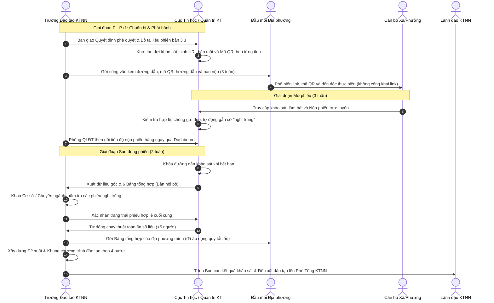
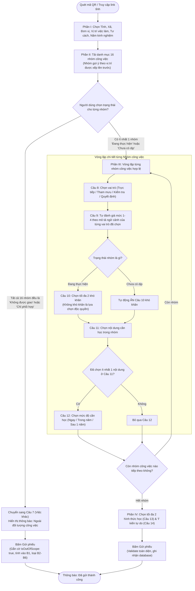
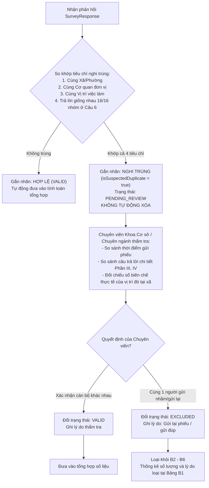

# 06. BUSINESS WORKFLOWS — QUY TRÌNH NGHIỆP VỤ HỆ THỐNG

## 1. QUY TRÌNH VÒNG ĐỜI MỘT ĐỢT KHẢO SÁT (CAMPAIGN LIFECYCLE WORKFLOW)

Quy trình chuẩn được thiết kế theo tiến độ từ tuần $P$ (ngày phê duyệt) đến $P+7$ tuần theo văn bản Phương án triển khai.



---

## 2. QUY TRÌNH TRẢI NGHIỆM LÀM BÀI KHẢO SÁT CỦA CÁN BỘ (RESPONDENT UX JOURNEY)



---

## 3. QUY TRÌNH PHÁT HIỆN VÀ RÀ SOÁT PHIẾU NGHI TRÙNG (DUPLICATES REVIEW WORKFLOW)



---

## 4. QUY TRÌNH THUẬT TOÁN ẨN DANH SỐ LIỆU NHÓM NHỎ (SUPPRESSION WORKFLOW)

Quy trình áp dụng cho việc công bố số liệu ra bên ngoài hoặc tài khoản Đầu mối địa phương:

```mermaid
flowchart TD
    InputCell["Duyệt qua từng ô số liệu và ô mẫu số trong Bảng B1 - B6"] --> CheckZero{"Giá trị ô = 0?"}
    CheckZero -->|Đúng| KeepZero["Cho phép công bố (Hiển thị 0)"]
    CheckZero -->|Sai| CheckThreshold{"Giá trị ô ∈ [1, 4]?"}
    
    CheckThreshold -->|Đúng| PrimarySup["ÁP DỤNG PRIMARY SUPPRESSION:<br>Thay thế giá trị bằng chuỗi: 'dưới 5 - không công bố'"]
    CheckThreshold -->|Sai (Giá trị >= 5)| KeepVal["Giữ nguyên giá trị số"]
    
    PrimarySup --> CheckRowDenom{"Ô này có phải là mẫu số của dòng?"}
    CheckRowDenom -->|Đúng| RowSup["ÁP DỤNG ROW SUPPRESSION:<br>Ẩn toàn bộ dòng (kể cả tỷ lệ % và khoảng thiếu hụt)"]
    CheckRowDenom -->|Không| NextCheck["Tiếp tục kiểm tra tổng"]
    
    RowSup --> CheckSecondary["Kiểm tra Secondary Suppression"]
    KeepVal --> CheckSecondary
    NextCheck --> CheckSecondary
    
    subgraph SecSup ["Thuật toán Secondary Suppression"]
        CheckSecondary --> SumCheck{"Hàng hoặc cột có ô Tổng (Total)?<br>Và trong hàng/cột đó chỉ có DUY NHẤT 1 ô bị ẩn?"}
        SumCheck -->|Đúng| FindMin["Tìm ô có giá trị nhỏ nhất kế tiếp trong hàng/cột đó"]
        FindMin --> SupMin["Thực hiện ẩn bổ sung ô nhỏ nhất đó<br>(Chống việc lấy Tổng trừ để suy ra ô ẩn)"]
        SumCheck -->|Sai| EndSec["Không cần ẩn bổ sung"]
    end
    
    SupMin --> FinalOutput["Bảng Báo cáo an toàn bàn giao cho Địa phương"]
    EndSec --> FinalOutput
```

---

## 5. QUY TRÌNH 4 BƯỚC CHUYỂN HÓA KẾT QUẢ THÀNH CHƯƠNG TRÌNH ĐÀO TẠO

Căn cứ quy định tại Phần V Tài liệu số 2:
1. **Bước 1 (Xuất & Đối chiếu dữ liệu):** Cục Tin học xuất dữ liệu gốc và 6 bảng tổng hợp; Khoa Cơ sở đối chiếu chéo số liệu trước khi đưa vào sử dụng.
2. **Bước 2 (Lập Đề xuất đào tạo từng địa phương):** Khoa Cơ sở và Khoa Chuyên ngành lập phiếu đề xuất đào tạo căn cứ vào:
   - Quy mô nhu cầu (Tỷ lệ người dưới mức yêu cầu ở Bảng B3).
   - Tính chất nhu cầu (Phân bố thiếu 1 mức vs thiếu 2-3 mức ở B3).
   - Nội dung cấp thiết cần học ngay (Bảng B4).
   - Khó khăn nội tại về kiến thức, kỹ năng (Bảng B5) tách biệt với khó khăn thể chế/công cụ.
   - Hình thức học ưu tiên của địa phương (Bảng B6).
3. **Bước 3 (Chuyển thành Chương trình đào tạo):** Hội đồng/Ban Biên soạn chuyển đề xuất thành khung chương trình chi tiết: Đối tượng, Nội dung chuyên đề, Hình thức tổ chức, Thời lượng.
4. **Bước 4 (Báo cáo & Phổ biến kết quả):** Giám đốc Trường ký Báo cáo trình Lãnh đạo Kiểm toán nhà nước; đồng thời gửi Bảng tổng hợp đã ẩn danh cho địa phương.
