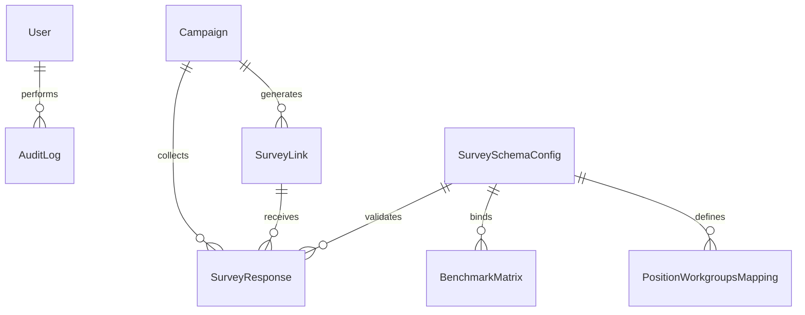

# 08. DATABASE DESIGN — THIẾT KẾ CƠ SỞ DỮ LIỆU MONGODB

Hệ thống sử dụng MongoDB với ODM Mongoose, thiết kế tối ưu cho biểu mẫu động, truy vấn tổng hợp phức hợp và bảo đảm toàn vẹn dữ liệu.

---

## 1. SƠ ĐỒ THỰC THỂ LIÊN KẾT (DATA MODEL RELATIONSHIPS)



---

## 2. CHI TIẾT CÁC COLLECTIONS VÀ SCHEMAS

### 2.1. Collection: `users`
- **Mục đích:** Quản lý tài khoản quản trị và phân quyền RBAC.
- **Fields:**
  - `_id`: `ObjectId` (Primary Key).
  - `username`: `String`, required, unique, trim, lowercase.
  - `email`: `String`, required, unique, trim, lowercase.
  - `passwordHash`: `String`, required (bcrypt hash).
  - `fullName`: `String`, required.
  - `organization`: `String`, required (e.g., "Trường Đào tạo KTNN", "Cục Tin học", "UBND Tỉnh A").
  - `role`: `String`, enum: `['TECHNICAL_ADMIN', 'CONTENT_ADMIN', 'REVIEWER', 'PROGRESS_MONITOR', 'LOCAL_COORDINATOR']`, required.
  - `assignedProvinceCodes`: `[String]`, default: `[]` (Áp dụng cho `LOCAL_COORDINATOR`).
  - `isActive`: `Boolean`, default: `true`.
  - `failedLoginAttempts`: `Number`, default: `0`.
  - `lockedUntil`: `Date`, default: `null`.
  - `lastLoginAt`: `Date`.
  - `createdAt`, `updatedAt`: `Date` (Timestamps).
- **Indexes:**
  - `{ username: 1 }` (unique)
  - `{ email: 1 }` (unique)
  - `{ role: 1 }`

---

### 2.2. Collection: `campaigns`
- **Mục đích:** Quản lý các đợt khảo sát, thời gian bắt đầu, kết thúc và danh sách địa bàn.
- **Fields:**
  - `_id`: `ObjectId`.
  - `code`: `String`, required, unique (e.g., "DOT-1-2026", "PILOT-2026").
  - `title`: `String`, required (e.g., "Khảo sát nhu cầu đào tạo tài chính tài sản công Đợt 1").
  - `schemaVersion`: `String`, required, default: "3.3".
  - `startDate`: `Date`, required.
  - `endDate`: `Date`, required.
  - `status`: `String`, enum: `['DRAFT', 'OPEN', 'CLOSED', 'ARCHIVED']`, default: `'DRAFT'`.
  - `participatingProvinces`: `[Array of Objects]`:
    - `provinceCode`: `String`, required.
    - `provinceName`: `String`, required.
    - `targetRespondents`: `Number`, default: `0` (Số lượng dự kiến theo danh sách địa phương).
  - `description`: `String`.
  - `createdBy`: `ObjectId`, ref: `'User'`.
  - `createdAt`, `updatedAt`: `Date`.
- **Indexes:**
  - `{ code: 1 }` (unique)
  - `{ status: 1 }`

---

### 2.3. Collection: `survey_links`
- **Mục đích:** Quản lý liên kết riêng và mã QR cho từng tỉnh trong một đợt khảo sát.
- **Fields:**
  - `_id`: `ObjectId`.
  - `campaignId`: `ObjectId`, ref: `'Campaign'`, required.
  - `provinceCode`: `String`, required.
  - `provinceName`: `String`, required.
  - `token`: `String`, required, unique (Secure random token / nanoid 21 ký tự).
  - `qrCodeDataUrl`: `String` (Base64 data URL của mã QR).
  - `status`: `String`, enum: `['ACTIVE', 'PAUSED', 'EXPIRED']`, default: `'ACTIVE'`.
  - `isPilot`: `Boolean`, default: `false` (Đường dẫn trả lời thử).
  - `totalSubmissions`: `Number`, default: `0`.
  - `lastSubmissionAt`: `Date`.
  - `createdAt`, `updatedAt`: `Date`.
- **Indexes:**
  - `{ token: 1 }` (unique)
  - `{ campaignId: 1, provinceCode: 1 }` (unique compound)
  - `{ status: 1 }`

---

### 2.4. Collection: `survey_schema_configs`
- **Mục đích:** Lưu trữ định nghĩa cấu trúc bộ câu hỏi bất biến theo phiên bản (Versioning).
- **Fields:**
  - `_id`: `ObjectId`.
  - `version`: `String`, required, unique (e.g., "3.3").
  - `isApproved`: `Boolean`, default: `false`.
  - `approvedAt`: `Date`.
  - `approvedBy`: `String` (e.g., "Phó Tổng Kiểm toán nhà nước phụ trách").
  - `workgroups`: `[Array of Objects]` (Danh mục 16 nhóm N01 - N16):
    - `id`: `String` (e.g., "N01").
    - `order`: `Number` (1 đến 16).
    - `title`: `String`, required.
    - `description`: `String`.
    - `learningTopics`: `[Array of Objects]`:
      - `topicId`: `String`.
      - `topicTitle`: `String`.
  - `roles`: `[Array of Objects]` (4 vai trò):
    - `roleId`: `String` (`'DIRECT'`, `'ADVISORY'`, `'SUPERVISORY'`, `'APPROVAL'`).
    - `title`: `String`.
    - `levelDescriptions`: Map `level (1-4) -> String`.
  - `difficulties`: `[Array of Objects]` (6 khó khăn + 1 mục độc quyền).
  - `learningFormats`: `[Array of Objects]` (5 hình thức học).
  - `createdAt`, `updatedAt`: `Date`.
- **Indexes:**
  - `{ version: 1 }` (unique)

---

### 2.5. Collection: `benchmark_matrices`
- **Mục đích:** Lưu ma trận mức yêu cầu đã phê duyệt tương ứng với từng phiên bản bộ phiếu.
- **Fields:**
  - `_id`: `ObjectId`.
  - `schemaVersion`: `String`, required, ref: `'SurveySchemaConfig.version'`.
  - `workgroupId`: `String`, required (e.g., "N01").
  - `roleId`: `String`, required (`'DIRECT'`, `'ADVISORY'`, `'SUPERVISORY'`, `'APPROVAL'`).
  - `requiredLevel`: `Number`, required, min: 1, max: 4.
  - `rationale`: `String` (Lý do giải thích mức chuẩn).
- **Indexes:**
  - `{ schemaVersion: 1, workgroupId: 1, roleId: 1 }` (unique compound)

---

### 2.6. Collection: `position_workgroups_mappings`
- **Mục đích:** Cấu hình danh mục nhóm công việc ưu tiên xếp trước cho từng cơ quan & vị trí việc làm.
- **Fields:**
  - `_id`: `ObjectId`.
  - `schemaVersion`: `String`, required.
  - `agencyCode`: `String`, required (1 trong 11 cơ quan).
  - `agencyName`: `String`, required.
  - `positionCode`: `String`, required.
  - `positionTitle`: `String`, required.
  - `suggestedWorkgroupIds`: `[String]`, required (Mảng các ID nhóm ví dụ `["N01", "N02", "N04"]`).
  - `commonRoleId`: `String` (Vai trò thường gặp).
  - `estimatedMinutes`: `Number` (Thời gian ước tính hoàn thành: 8 - 17 phút).
- **Indexes:**
  - `{ schemaVersion: 1, agencyCode: 1, positionCode: 1 }` (unique compound)

---

### 2.7. Collection: `survey_responses` (Trọng tâm)
- **Mục đích:** Lưu trữ toàn bộ câu trả lời của người tham gia khảo sát. Thiết kế tối ưu cho form động và bảo mật ẩn danh.
- **Fields:**
  - `_id`: `ObjectId`.
  - `campaignId`: `ObjectId`, ref: `'Campaign'`, required.
  - `linkId`: `ObjectId`, ref: `'SurveyLink'`, required.
  - `schemaVersion`: `String`, required, default: "3.3".
  
  - **Phần I — Thông tin chung:**
    - `part1`: `Object`:
      - `provinceCode`: `String`, required.
      - `provinceName`: `String`, required.
      - `communeCode`: `String`, required.
      - `communeName`: `String`, required.
      - `agencyCode`: `String`, required.
      - `agencyName`: `String`, required.
      - `positionCode`: `String`, required.
      - `positionTitle`: `String`, required.
      - `positionOtherText`: `String`, default: `null`.
      - `capacities`: `[String]`, required (Tư cách: Cán bộ, Công chức...).
      - `capacitiesOtherText`: `String`, default: `null`.
      - `experienceYears`: `String`, enum: `['LT_1', '1_TO_3', 'GT_3']`, required.

  - **Phần II — Khai báo nhóm công việc:**
    - `part2`: `Object`:
      - `workgroupStatuses`: `[Array of Objects]` (Đủ 16 nhóm):
        - `workgroupId`: `String`, required (e.g., "N01").
        - `status`: `String`, enum: `['CURRENTLY_DOING', 'ASSIGNED_NOT_YET', 'COORDINATING_ONLY', 'NOT_ASSIGNED']`, required.
      - `otherWorkText`: `String`, maxlength: 300, default: `null` (Câu 7).

  - **Phần III — Đánh giá theo từng nhóm công việc (Dynamic Subdocuments):**
    - `part3`: `[Array of Objects]` (Chỉ chứa các nhóm có trạng thái `CURRENTLY_DOING` hoặc `ASSIGNED_NOT_YET`):
      - `workgroupId`: `String`, required.
      - `status`: `String`, required (Snapshot lại trạng thái lúc trả lời).
      - `roles`: `[String]`, required (Mảng vai trò đảm nhiệm: `DIRECT`, `ADVISORY`, `SUPERVISORY`, `APPROVAL`).
      - `evaluations`: `[Array of Objects]` (Câu 9: Điểm tự đánh giá cho từng vai trò đã chọn):
        - `roleId`: `String`, required.
        - `selfAssessedLevel`: `Number`, min: 1, max: 4, required.
      - `difficulties`: `[String]`, max: 2, default: `[]` (Câu 10: Chỉ có nếu trạng thái là `CURRENTLY_DOING`).
      - `selectedTopics`: `[String]`, default: `[]` (Câu 11: Mảng ID nội dung cần học).
      - `selectedTopicsOtherText`: `String`, default: `null`.
      - `urgencyLevel`: `String`, enum: `['IMMEDIATE_6M', 'WITHIN_YEAR', 'AFTER_1Y', null]`, default: `null` (Câu 12).

  - **Phần IV — Hình thức học & Ý kiến khác:**
    - `part4`: `Object`:
      - `preferredFormats`: `[String]`, max: 2, required (Câu 13).
      - `otherOpinions`: `String`, maxlength: 500, default: `null` (Câu 14).

  - **Cờ phân loại & Kiểm soát chất lượng:**
    - `isOutOfScope`: `Boolean`, default: `false` (Đúng nếu cả 16 nhóm đều là Không được giao hoặc Chỉ phối hợp).
    - `businessHash`: `String`, required (Mã băm SHA-256 từ `communeCode + agencyCode + positionCode + 16_statuses_sorted`).
    - `isSuspectedDuplicate`: `Boolean`, default: `false`.
    - `duplicateGroupId`: `String`, default: `null`.
    - `reviewStatus`: `String`, enum: `['VALID', 'EXCLUDED', 'PENDING_REVIEW']`, default: `'VALID'`.
    - `exclusionReason`: `String`, default: `null`.
    - `reviewedBy`: `ObjectId`, ref: `'User'`, default: `null`.
    - `reviewedAt`: `Date`, default: `null`.
    - `submittedAt`: `Date`, default: `Date.now`, required.
- **Indexes:**
  - `{ campaignId: 1, "part1.provinceCode": 1, reviewStatus: 1 }` (Tối ưu xuất báo cáo tỉnh)
  - `{ campaignId: 1, schemaVersion: 1, reviewStatus: 1 }` (Tối ưu tổng hợp toàn quốc)
  - `{ businessHash: 1, campaignId: 1 }` (Tối ưu phát hiện phiếu nghi trùng)
  - `{ linkId: 1 }`
  - `{ submittedAt: 1 }`

---

### 2.8. Collection: `audit_logs`
- **Mục đích:** Ghi nhận lịch sử kiểm toán các hành động trên hệ thống.
- **Fields:**
  - `_id`: `ObjectId`.
  - `userId`: `ObjectId`, ref: `'User'`, required.
  - `username`: `String`, required.
  - `action`: `String`, required (e.g., `'LOGIN'`, `'CLOSE_LINK'`, `'REVIEW_DUPLICATE'`, `'EXPORT_EXCEL'`).
  - `targetResource`: `String`.
  - `details`: `Object` (Payload chi tiết).
  - `ipAddress`: `String`.
  - `userAgent`: `String`.
  - `createdAt`: `Date`, default: `Date.now`.
- **Indexes:**
  - `{ createdAt: -1 }`
  - `{ userId: 1, action: 1 }`

---

## 3. VÍ DỤ DOCUMENT JSON THỰC TẾ

### Ví dụ 1: Một bản ghi `survey_responses` hợp lệ (Chủ tịch UBND xã trả lời)
```json
{
  "_id": "67362a1b9c1d8f0012a45b81",
  "campaignId": "673628fa9c1d8f0012a45b70",
  "linkId": "6736290e9c1d8f0012a45b75",
  "schemaVersion": "3.3",
  "part1": {
    "provinceCode": "01",
    "provinceName": "Thành phố Hà Nội",
    "communeCode": "00015",
    "communeName": "Xã Ba Vì",
    "agencyCode": "UBND_LEADERSHIP",
    "agencyName": "Lãnh đạo Ủy ban nhân dân xã/phường",
    "positionCode": "CHAIRMAN",
    "positionTitle": "Chủ tịch Ủy ban nhân dân",
    "positionOtherText": null,
    "capacities": ["CAN_BO", "DAI_BIEU_HDND"],
    "capacitiesOtherText": null,
    "experienceYears": "GT_3"
  },
  "part2": {
    "workgroupStatuses": [
      { "workgroupId": "N01", "status": "CURRENTLY_DOING" },
      { "workgroupId": "N02", "status": "CURRENTLY_DOING" },
      { "workgroupId": "N03", "status": "NOT_ASSIGNED" },
      { "workgroupId": "N04", "status": "CURRENTLY_DOING" },
      { "workgroupId": "N05", "status": "CURRENTLY_DOING" },
      { "workgroupId": "N06", "status": "NOT_ASSIGNED" },
      { "workgroupId": "N07", "status": "CURRENTLY_DOING" },
      { "workgroupId": "N08", "status": "NOT_ASSIGNED" },
      { "workgroupId": "N09", "status": "CURRENTLY_DOING" },
      { "workgroupId": "N10", "status": "CURRENTLY_DOING" },
      { "workgroupId": "N11", "status": "NOT_ASSIGNED" },
      { "workgroupId": "N12", "status": "COORDINATING_ONLY" },
      { "workgroupId": "N13", "status": "CURRENTLY_DOING" },
      { "workgroupId": "N14", "status": "CURRENTLY_DOING" },
      { "workgroupId": "N15", "status": "ASSIGNED_NOT_YET" },
      { "workgroupId": "N16", "status": "NOT_ASSIGNED" }
    ],
    "otherWorkText": null
  },
  "part3": [
    {
      "workgroupId": "N01",
      "status": "CURRENTLY_DOING",
      "roles": ["APPROVAL"],
      "evaluations": [
        { "roleId": "APPROVAL", "selfAssessedLevel": 3 }
      ],
      "difficulties": ["QUY_TRINH", "NHAN_LUC"],
      "selectedTopics": ["N01_T01", "N01_T02"],
      "selectedTopicsOtherText": null,
      "urgencyLevel": "IMMEDIATE_6M"
    },
    {
      "workgroupId": "N15",
      "status": "ASSIGNED_NOT_YET",
      "roles": ["APPROVAL"],
      "evaluations": [
        { "roleId": "APPROVAL", "selfAssessedLevel": 2 }
      ],
      "difficulties": [],
      "selectedTopics": ["N15_T02"],
      "selectedTopicsOtherText": null,
      "urgencyLevel": "WITHIN_YEAR"
    }
  ],
  "part4": {
    "preferredFormats": ["ONLINE", "HYBRID"],
    "otherOpinions": "Đề nghị cung cấp thêm sổ tay điện tử về quy trình kiểm tra quyết toán ngân sách xã sau sáp nhập."
  },
  "isOutOfScope": false,
  "businessHash": "e3b0c44298fc1c149afbf4c8996fb92427ae41e4649b934ca495991b7852b855",
  "isSuspectedDuplicate": false,
  "duplicateGroupId": null,
  "reviewStatus": "VALID",
  "exclusionReason": null,
  "submittedAt": "2026-11-14T17:42:00.000Z"
}
```
